# Network Traffic Analysis and Reconnaissance on AWS

I built a small network of Ubuntu EC2 instances on AWS and studied traffic at the packet level: how TCP/IP really behaves, how scans look to a defender, what an unencrypted login exposes, and how to spot internet scanners hitting a server.

**Environment:** AWS EC2 (Ubuntu) in one VPC, with Sender/Analyzer and Scanner/Target instances · tcpdump · Nmap · dig · curl · traceroute · ncat
**Built as part of:** TELE 30004 Network Security Analysis, Sheridan College (Winter 2026)

## Highlights

- **Found real attack traffic:** a SIP scanning tool probing my instance from the internet.
- **Watched scans from the defender's side:** SYN vs full connect vs ACK vs FIN scans in tcpdump.
- **Showed why HTTPS matters:** a full HTTP request and page captured in plain text.
- **Mapped firewall behaviour:** filtered vs closed vs open, and drop vs reject.

## 1. Real-world finding: an internet scanner in my capture

While capturing my own pings, packets I never sent appeared: a SIP `OPTIONS` request on port 5060 with the user agent **sipvicious**, a well-known VoIP scanning tool. Any instance with a public IP gets probed like this within minutes. My server had no SIP service, so the kernel answered "port unreachable".

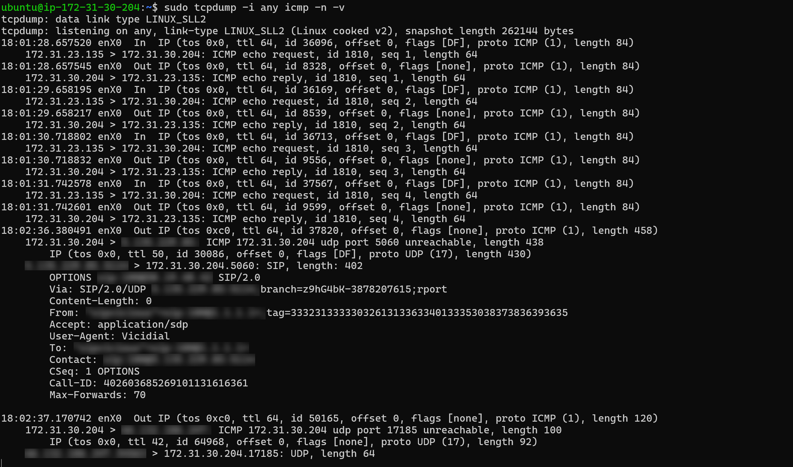

**Takeaway for a SOC:** background scanning is constant. The skill is telling this noise apart from a targeted attack, and making sure security groups block anything a server doesn't serve.

## 2. Packets at the TCP/IP level

```bash
# Capture only fragmented IP packets (MF flag set or offset > 0)
sudo tcpdump -i any 'ip[6:2] & 0x3fff != 0' -n -v
# Send a ping too big for one packet, so it gets fragmented
ping -s 4000 -c 3 <analyzer-ip>
# Save packets to a file for later analysis in Wireshark
sudo tcpdump -i any -w fragments.pcap 'ip[6:2] & 0x3fff != 0' -c 20
```

| Fragmented ping (offset 0 then 8976) | Saved as PCAP evidence |
|---|---|
| 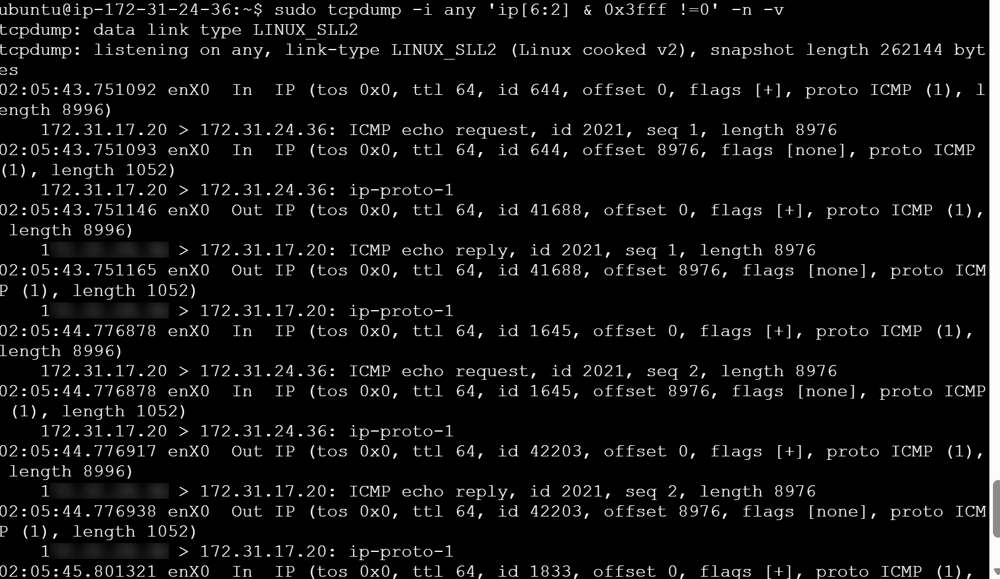 | 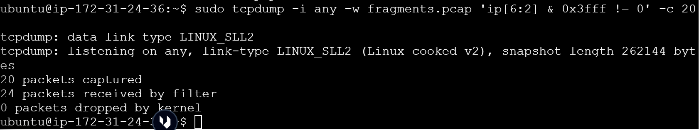 |

**Why it matters:** attackers split headers across tiny fragments to slip past simple firewalls. Saving PCAPs preserves evidence for an investigation.

## 3. Stimulus and response: what a host reveals

| You send | Open port | Closed port | Firewall drops it |
|---|---|---|---|
| TCP SYN | SYN/ACK | RST/ACK | Nothing |
| UDP | App reply or nothing | ICMP port unreachable | Nothing |

A connection to a closed port comes straight back with `[R.]` (reset):

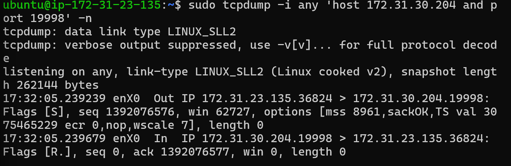

Traceroute exploits ICMP Time Exceeded (type 11) to map each hop to 8.8.8.8:

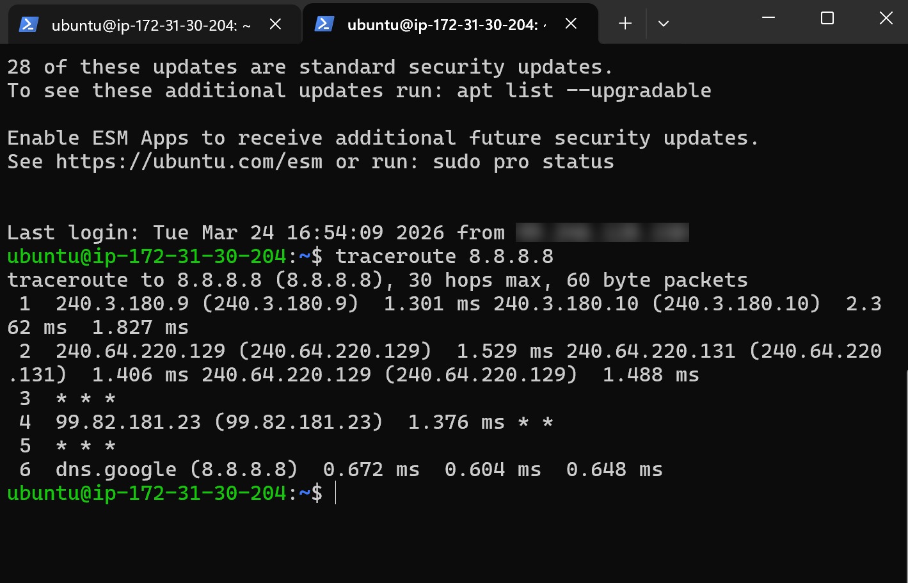

**Takeaway:** silently dropping is safer than rejecting, because a reset confirms to an attacker that the host exists.

## 4. Scanning, seen from both sides

I locked the Target's security group to one inbound rule (the Scanner's private IP only), then scanned while capturing on the Target.

```bash
# Half-open SYN scan: never completes the handshake
sudo nmap -sS -p 22,80,443 <target-ip>
# Full connect scan: completes the handshake (more likely to be logged)
nmap -sT -p 22,80,443 <target-ip>
# ACK scan: maps firewall rules instead of open ports
sudo nmap -sA -p 22,80,443 <target-ip>
# Identify the exact service version
sudo nmap -sV <target-ip>
```

| SYN scan on the wire: `[S]` → `[S.]` → `[R]` | Connect scan: full handshake, then reset |
|---|---|
| 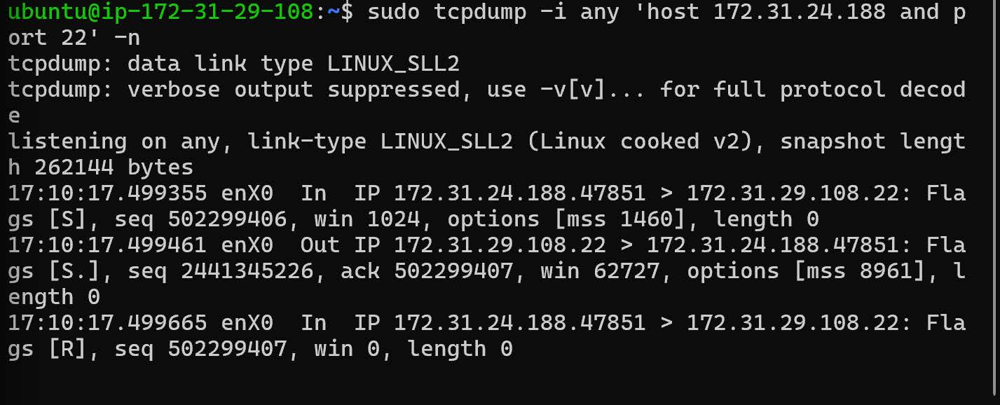 | 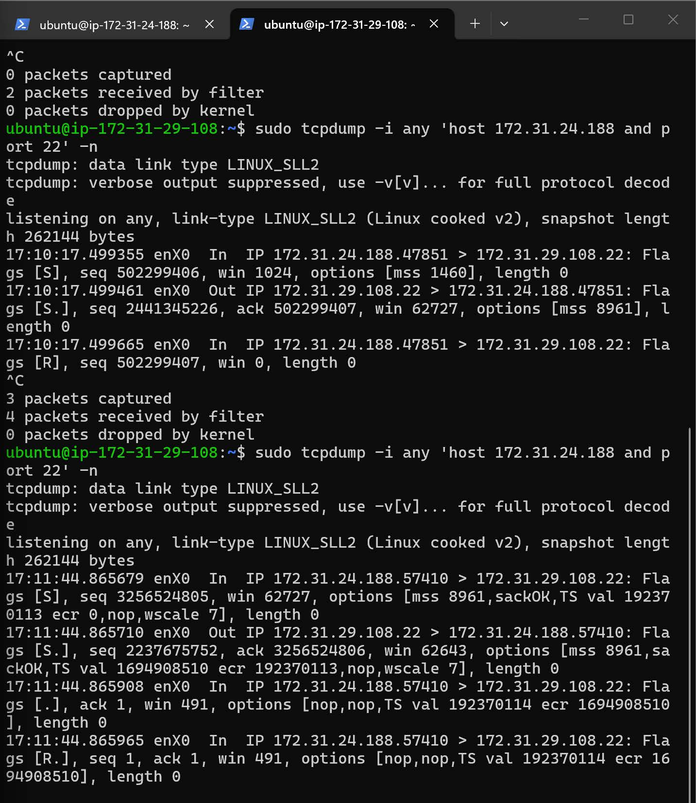 |

ACK scan shows all ports **filtered** (the AWS security group is stateful). The FIN scan shows **open|filtered**:

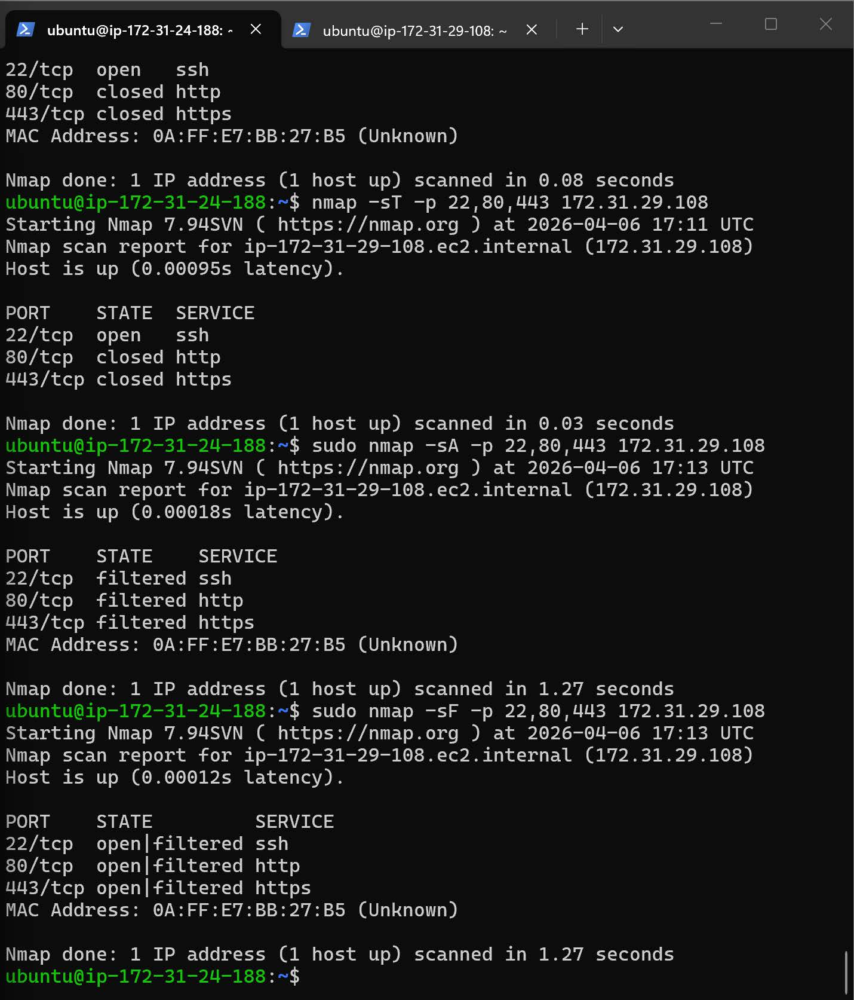

Version detection found **OpenSSH 9.6p1 on Ubuntu**, which I checked against known CVEs, including CVE-2024-6387 ("regreSSHion"):

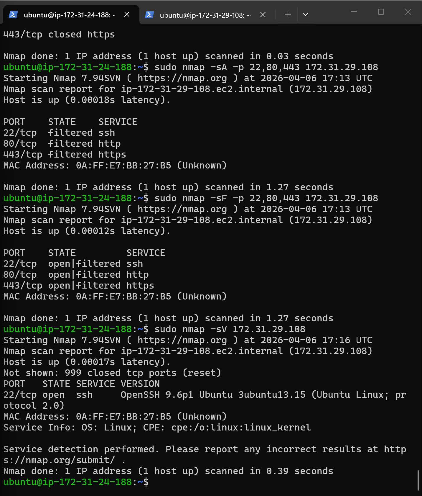

## 5. HTTP security

Captured an HTTP session: the request line, headers and the full page are readable in plain text. A login sent this way would expose the username and password to anyone on the network.

```bash
# Print packet contents as text (-A) for web traffic
sudo tcpdump -i any -A port 80 -c 50
```

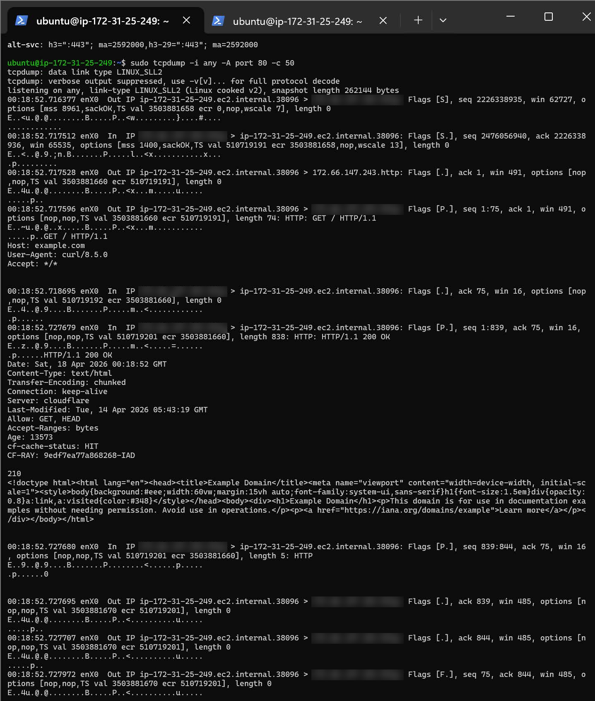

I also set and replayed session cookies, and compared security headers (HSTS, X-Frame-Options, Content-Security-Policy, nosniff) between two real websites.

| Cookies | Security headers |
|---|---|
| 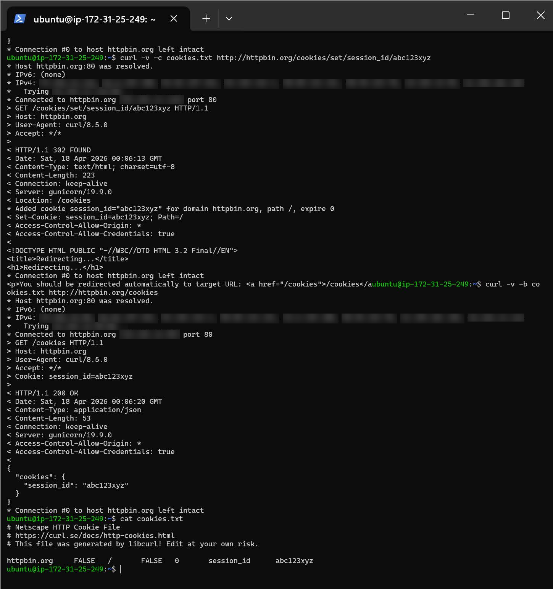 | 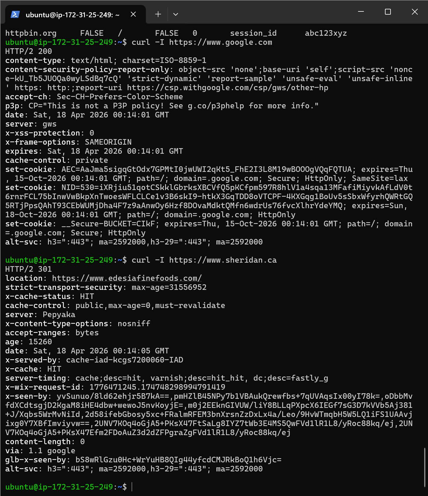 |

## Problems I hit

- **SSH key "not found":** the key file had a different name than I was typing. Used the real path.
- **Linux commands did nothing:** I was typing in my PC's PowerShell, not inside the SSH session. Now I always check the prompt first.
- **Nmap couldn't identify the OS:** few open ports plus cloud virtualization confuse fingerprinting. Version detection gave a better answer.

## What I learned

- **Packet captures are ground truth.** Tools summarize, but tcpdump shows exactly what happened.
- **Least-privilege firewall rules work.** One rule for one IP, not the whole internet.
- **Every service version is a lookup away from its CVEs,** which is why patching and hiding version banners matter.
- **Only scan what you're authorized to scan.** I scanned only my own instances and Nmap's official test host, `scanme.nmap.org`.
-e 
More detail on these problems is in my [IT Troubleshooting Log](https://github.com/ikassem-cyber/it-troubleshooting-log/blob/main/cases/06-network-analysis.md).
